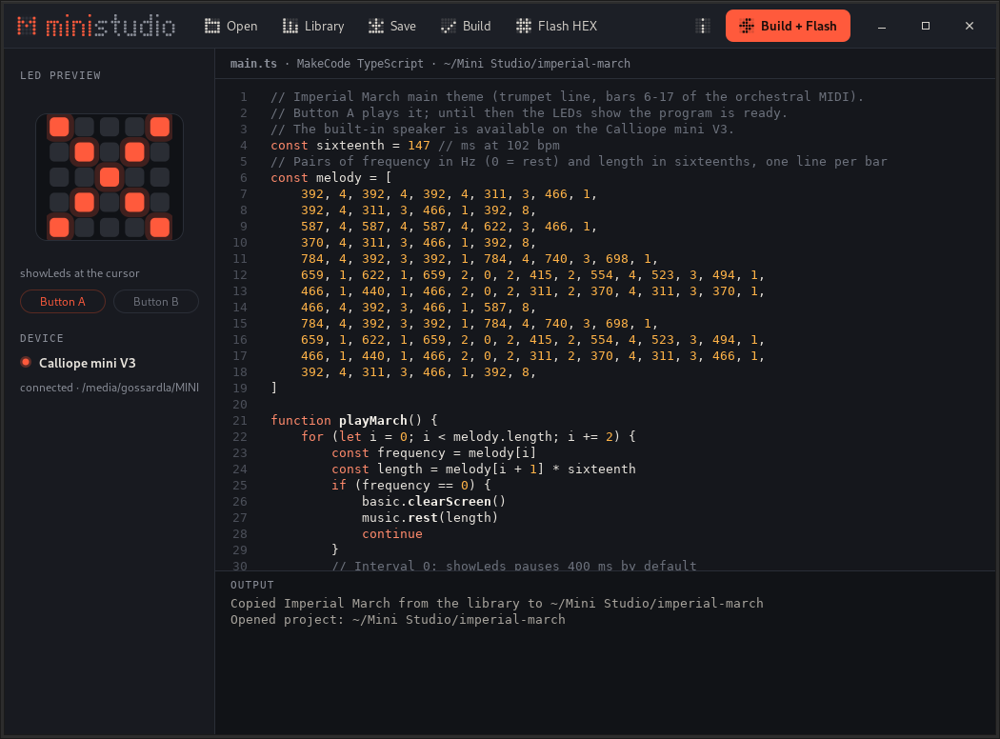

# Mini Studio

Linux editor for MakeCode TypeScript on the Calliope mini V3, with a library
of ready-made projects.



## Start

Requires Python 3, PyGObject/GTK 3 with pycairo (Debian/Ubuntu: `python3-gi`,
`python3-gi-cairo`, `gir1.2-gtk-3.0`), Node.js and the official
[MakeCode CLI `mkc`](https://github.com/microsoft/pxt-mkc):

```sh
npm install -g makecode
make debug
```

`make flash` builds a library project (`EXAMPLE=imperial-march` by default)
and copies the HEX to a mounted Calliope mini V3 without the editor; `make install` puts the editor into `~/.local`, together
with a desktop entry and the app icon.

Edit `main.ts` in the editor and click **Build + Flash**.
On the first build `mkc` downloads the Calliope compiler from
`https://makecode.calliope.cc/`, so an internet connection is needed.
The app only writes to the `MINI` drive if its DAPLink info file identifies
a Calliope mini V3. Alternatively, an already compiled `.hex` file can be
flashed with **Flash HEX**.

The code is MakeCode TypeScript; `mkc` cannot compile plain JavaScript or
MicroPython in this project.

## Library

Every entry is a MakeCode project in `library/<slug>/`, next to its sources
(MIDI and the like), and is listed in `library.py`. **Library** copies the
entry to `~/Documents/Mini Studio/<slug>` (the localised documents folder) and
opens the copy; an existing copy is opened as it is, so own changes survive.
On start the app opens the first entry.

| Entry | Source | Notes |
|---|---|---|
| `imperial-march` | `imperial-march.mid`, trumpet, bars 6–17 | quantised to sixteenths, 102 bpm |
| `deep-space-nine` | `deep-space-nine.mid`, horn and trumpet | timing in ms as recorded, top note of horn chords |

Both melodies play on button A, with the LED matrix blinking in time; until
then the matrix shows a still image so the mini is visibly ready.

## Look

Mini Studio brings its own dark “Matrix” theme (`mini-studio.css` on top of
Adwaita) instead of the desktop theme. Mark, wordmark and icons are 5×5 LED
patterns drawn in `matrix.py`; `mini-studio.svg` is the app icon. `make screenshot` renders `docs/screenshot.png` headless
in English from a fresh library copy. The sidebar
previews the `showLeds` image at the cursor and shows whether the program uses
buttons A and B. Fonts: Atkinson Hyperlegible and JetBrains Mono if installed,
otherwise the usual fallbacks.

## Translations

The interface is English, with German as the second language. Source strings
live in the code, translations in `po/<language>.po`: `make pot` extracts new
strings and merges them, `make locale` compiles them, and `make lint` fails on
any untranslated string. The language follows `LANGUAGE`/`LANG`; console output
of `make flash` stays English.

## Licence

MIT, see `LICENSE`. The melodies in the library are taken from the MIDI files
next to them: the Imperial March is a composition by John Williams, the
Deep Space Nine main title one by Dennis McCarthy.
